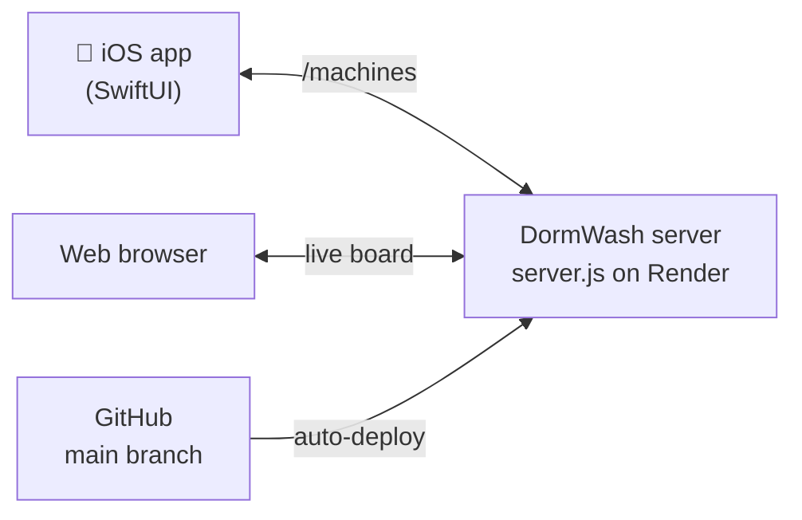

<div align="center">

# 🧺 DormWash

**Book the machine. Track the cycle. Never make a wasted laundry trip again.**

A laundry app for residence halls that lets students reserve a specific washer or dryer, see a live countdown of their cycle, and report broken machines to maintenance.

[](https://github.com/RyanKeleher/DormWash/actions/workflows/ci-cd.yml)


[](LICENSE)

[** Live board**](https://dormwash-nv6w.onrender.com) · [Features](#-features) · [Getting started](#-getting-started) · [API](#-server-api) · [Contributing](#-contributing)

</div>

---

## 📖 Table of Contents

- [About the Project](#-about-the-project)
- [The Problem](#-the-problem)
- [Who It's For](#-who-its-for)
- [Features](#-features)
- [How It Works](#-how-it-works)
- [Project Structure](#-project-structure)
- [Getting Started](#-getting-started)
- [Server API](#-server-api)
- [CI/CD](#-cicd)
- [Contributing](#-contributing)
- [Roadmap](#-roadmap)
- [License](#-license)
- [Sources](#-sources)

---

## 💡 About the Project

Students don't mind doing laundry; it's essential. What they mind is the uncertainty: hauling a full basket to the laundry room only to find every machine running, broken, or tied up by someone's forgotten load.

**DormWash exists to guarantee the machine is free, not just to tell you where the machines are.**

### Product vision (Moore's template)

| Template | DormWash |
|---|---|
| **For** | Students living on campus in dorms or residence halls |
| **Who** | Are tired of wasted trips to the laundry room and machines tied up by forgotten loads |
| **The** | DormWash app is a laundry reservation system |
| **That** | Lets students book a specific machine and time slot, tracks cycle completion, and reminds them before pickup |
| **Unlike** | A paper sign-up sheet, or no system at all |
| **Our product** | Guarantees the machine is free when you arrive and nudges people to clear their laundry on time |

---

##  The Problem

Three questions drove our research:

1. **What actually causes a wasted trip?** Broken machines, no visibility into what's free, or loads left sitting after a cycle ends.
2. **How do students coordinate machine use today?** Paper sign-up sheets, group chats, or just guessing and hoping.
3. **What makes a reservation trustworthy?** Handling no-shows and machines blocked by someone else's finished laundry.

---

##  Who It's For

**Primary: residence hall students**, especially in dorms where machines are scarce compared to the number of residents and peak hours are competitive:

- First-year residents
- Students without a car
- Students with busy class schedules

**Secondary: Residence Life and facilities staff**, who manage machine uptime and want usage data to plan repairs. Reservation and cycle data can flag a chronically broken machine long before a paper complaint would.

---

##  Features

### Available now

| | Feature | Where |
|---|---|---|
|  | **Live cycle status**: the status screen loads the current cycle from the server and counts it down, with pull-to-refresh and a live/offline indicator | `appComponents/DormWashStatusView.swift` |
|  | **Washer screen**: animated drum with the cycle time and a *Smart Cycle Prediction* toggle (a mock-up that adds 5 minutes) | `appComponents/WasherTimerView.swift` |
|  | **Report a Problem**: pick an issue (won't start, leaking, won't drain, door stuck, other), add details, and the form checks the input before sending | `appComponents/WasherTimerView.swift` |
|  | **Live web board**: a countdown page anyone can open in a browser at [dormwash-nv6w.onrender.com](https://dormwash-nv6w.onrender.com) | `server.js` |
|  | **Automated checks**: every push builds the iOS code, runs its unit tests, and smoke-tests the server | `.github/workflows/ci-cd.yml` |

### Planned

-  Book a specific washer or dryer for a set time slot
-  Live view of which machines in a hall are free, running, or done
-  Reminders before pickup so machines get cleared promptly
-  Cycle completion tracking to discourage machine-hogging
-  Usage data to help facilities staff spot broken or overused machines

> **Note:** The current timer is a demo. The server runs a repeating 45-minute cycle for one sample machine (*Dryer 3B*), and maintenance reports are not yet sent anywhere real. The feature set will keep evolving as the project moves from product vision into design and development.

---

##  How It Works



1. The **iOS app** and the **web board** both ask the server for the current cycle.
2. The **server** works out the time left from the clock, so every viewer sees the same countdown.
3. Every merge to `main` **redeploys the server on Render automatically**.

---

##  Project Structure

```
DormWash/
├── appComponents/                   # Every screen, in Swift and as a web page
│   ├── WasherTimerView.swift        # Washer screen + Report a Problem form + request validation
│   ├── DormWashStatusView.swift     # Main status screen, live countdown, server connection
│   ├── dryer.html                   # Dryer web page, shown at "/"
│   ├── washer.html                  # Washer web page, shown at "/washer"
│   └── all.html                     # Dryer, washer and reports on one screen, shown at "/all"
├── Package.swift                    # Lets Xcode and CI build the Swift code as a package
├── Tests/
│   ├── DormWashTests/               # Swift unit tests for validation, timers, and view models
│   └── web/                         # Tests for the web pages: all.test.js, washer.test.js, dryer.test.js
├── server.js                        # The live server on Render (web pages + /machines + /reports + /status)
├── package.json                     # Start and test scripts for server.js
├── server/                          # Express API for maintenance reports (tested in CI)
│   ├── index.js
│   ├── smoke-test.js
│   └── package.json
├── .github/workflows/ci-cd.yml      # GitHub Actions: build, test, deploy
└── LICENSE
```

---

##  Getting Started

### Prerequisites

- **macOS with Xcode 15+** for the iOS app
- **Node.js 18+** for the server
- **Git** and a code editor (VS Code works well)

### 1. Clone the repository

```bash
git clone https://github.com/RyanKeleher/DormWash.git
cd DormWash
```

### 2. Run the iOS app

1. In Xcode, choose **File → Open…** and select the `DormWash` folder. It opens as a Swift package.
2. Open `appComponents/DormWashStatusView.swift` or `appComponents/WasherTimerView.swift` and use the **Canvas** (Option+Cmd+Return) to preview the screens.
3. Press **Cmd+U** to run the unit tests.

### 3. Run the server locally

```bash
npm start
```

Then open [http://localhost:3000](http://localhost:3000) to see the live board.

To test the All, Washer and Dryer pages (no install needed):

```bash
npm test     # runs Tests/web/all.test.js, washer.test.js and dryer.test.js
```

To run the maintenance-report API and its tests:

```bash
cd server
npm install
npm test     # smoke-tests every endpoint
npm start    # runs on http://localhost:3000
```

---

##  Server API

The live server is at **https://dormwash-nv6w.onrender.com**.

| Method | Endpoint | Returns |
|---|---|---|
| `GET` | `/` | The live board web page |
| `GET` | `/machines` | The current cycle as JSON |
| `GET` | `/status` | A health check: `{"message": "DormWash server is running"}` |

**Example: `GET /machines`**

```json
{
  "machineName": "Dryer 3B",
  "stage": "Drying",
  "remainingSeconds": 1590,
  "totalSeconds": 2700
}
```

The Express API in `server/` adds endpoints for maintenance reports. It isn't deployed yet and stores reports in memory only:

| Method | Endpoint | What it does |
|---|---|---|
| `POST` | `/maintenance-requests` | Saves a report. Body: `{ "machineID": "W4", "issue": "Leaking", "details": "..." }` |
| `GET` | `/maintenance-requests` | Lists saved reports |

> ⏳ The server runs on Render's free tier, so it goes to sleep after about 15 minutes without visitors. The first request after that can take up to a minute while it wakes up.

---

##  CI/CD

Every push and pull request runs the [CI/CD workflow](.github/workflows/ci-cd.yml) on GitHub Actions:

| Job | What it does |
|---|---|
| **iOS build & tests** | Builds the SwiftUI code on a Mac runner and runs the unit tests in `Tests/DormWashTests` on an iPhone simulator |
| **Server smoke test** | Installs the server in `server/` and checks every endpoint with `npm test` |
| **Web page tests** | Starts `server.js` and runs the All, Washer and Dryer page tests in `Tests/web` |
| **Deploy** | Runs only on `main`, after all checks pass. It packages the server as a downloadable build, and redeploys on Render if a `RENDER_DEPLOY_HOOK_URL` repository secret is set |

Render also redeploys `server.js` automatically whenever `main` changes.

> When you add a new `.swift` file to `appComponents/`, add its name to `sources` in `Package.swift` so CI builds it.

---

##  Contributing

We use a **branch → pull request → merge** workflow. Never commit straight to `main`.

```bash
# 1. Start from the latest main
git checkout main
git pull origin main

# 2. Create a branch for your change (no spaces in the name)
git checkout -b my-feature

# 3. Make your changes, then check what changed
git status
git diff

# 4. Stage and commit
git add appComponents/WasherTimerView.swift
git commit -m "feat: describe your change"

# 5. Push your branch
git push -u origin my-feature
```

6. On GitHub, click **Compare & pull request**, describe your change, and create the PR.
7. Wait for the CI checks to pass, get a teammate to review, then **Merge**.
8. Render redeploys automatically after the merge.

---

##  Roadmap

- [x] Product vision and research questions
- [x] Washer timer and Report a Problem screens
- [x] Live server on Render with a web board
- [x] Status screen connected to the server
- [x] CI/CD with GitHub Actions
- [ ] **Validate the research questions**: short resident survey on peak-hour frustration and current coordination habits
- [ ] **Booking flow**: wireframe the reserve-a-slot and cycle-reminder experience for one laundry room
- [ ] **Machine map**: a live view of a hall's washers and dryers
- [ ] Store machines, reservations, and reports in a real database
- [ ] Send Report a Problem submissions to the server
- [ ] Pickup reminders with push notifications

---

##  License

Distributed under the **MIT License**. See [`LICENSE`](LICENSE) for details.

---

##  Sources

- A. Pratts and S. Moquino, "ADVICE COLUMN: Campus laundry is the college experience no one talks about," *Hilltop Views*, Oct. 12, 2025.
- "Blocked," *Refinery29.com*, 2026.
- "5 Challenges Of Doing Laundry In College (And The Effortless Solution)," *The WashRoom Laundry Service*, Aug. 22, 2025.

---

<div align="center">

Made with by the DormWash team · [View contributors](https://github.com/RyanKeleher/DormWash/graphs/contributors)

</div>
